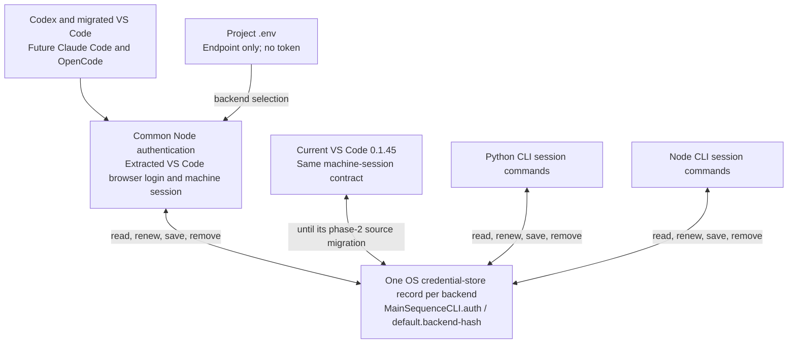
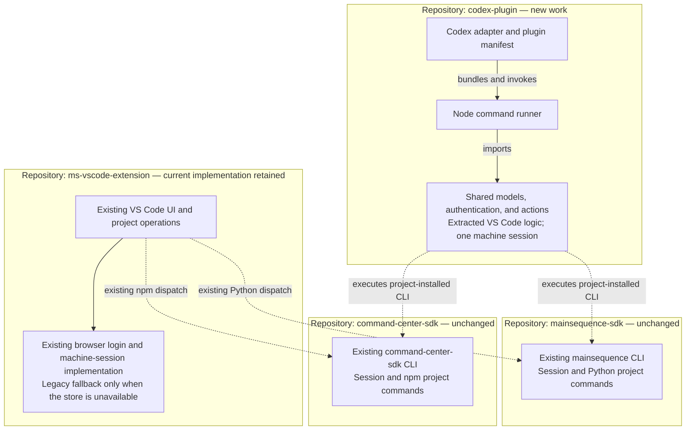
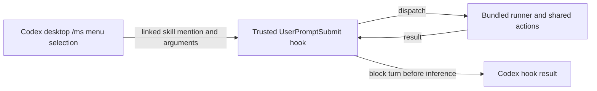
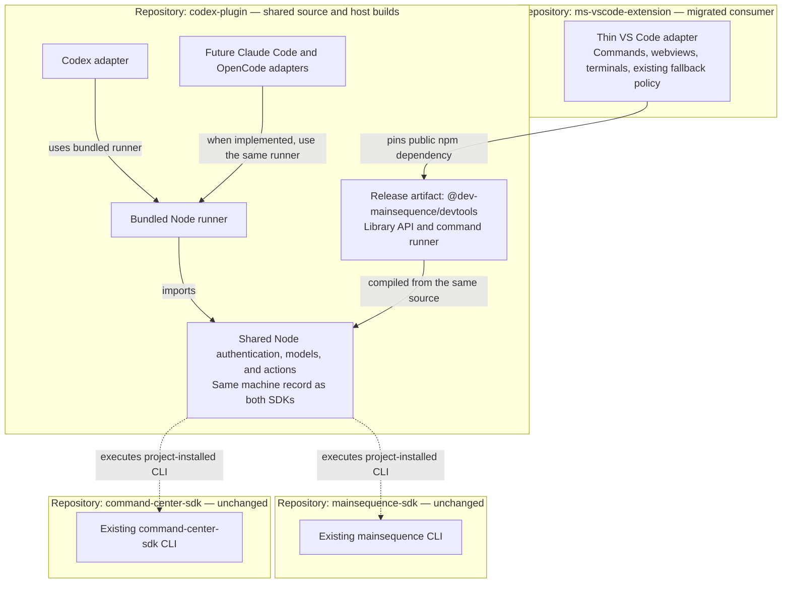

# ADR 0001: Shared developer tooling for Codex, VS Code, and future hosts

Amended 2026-10-09 by owner request to extend the Codex plugin with conversational project MCP connections. [ADR 0002](0002-conversational-project-mcp-client.md) owns the client, remembered selections, authentication reuse and native-host limitation. The no-MCP/no-model execution statements below describe the original deterministic developer actions; the new conversational skill guides the harness to a bundled MCP client. The runner itself makes no LLM API calls.

- **Status:** Accepted; phases 1 and 2 implemented.
- **Date:** 2026-09-30
- **Scope:** Developer tooling and its distribution across editor and agent hosts.
- **Revision:** Reanalyzed against Python SDK `development` and the current VS Code shared-session implementation on 2026-09-30.
- **Phase 1:** Extract reusable developer tooling and authentication from VS Code into this repository and build the Codex plugin; keep existing SDK project commands and the current VS Code release in place.
- **Phase 2:** Publish the shared npm package and migrate VS Code to consume it.
- **Amended 2026-10-01:** the shared tooling now behaves as the released tools do in four places. A project `.env` keeps its endpoint in the VS Code extension's block, as extension 0.1.45 writes it, and a file already in that form is not written again. Logout removes the legacy unscoped `default` entry without reading it, as the Python and Command Center CLIs do. A record is read by its fields whatever its `v`, as the other readers read it. A refused session says which credentials were refused, when they expired, and what repairs it.
- **Amended 2026-10-02:** sync only refreshes dependency files. The platform decided that a CodeRepository's versions and release tags are repository code (for example a GitHub Actions workflow) and that it deploys from Git pushes; it no longer hands out deployment tags. The SDKs' `code-repository sync` changed with it: Python `mainsequence` 9.0.5 runs `uv lock`, `uv sync` and the locked `requirements.txt` export; Command Center SDK 0.5.13 refreshes `package-lock.json` and runs `npm ci`. Neither takes a commit message, UID or dry run, runs a Git command, or contacts the backend; the person commits and pushes. This tooling now dispatches exactly `code-repository sync --path .`. An installed SDK whose sync help still offers `--dry-run` or `--message` has the retired release sync, which fails at the removed backend route; it is reported unavailable, with `update-sdk` and the minimum version as the repair, and is never run. The Codex backend preflight existed only for that sync and was removed. `freeze-env` was removed from the Python SDK and from this tooling, because sync performs its export. Existing library callers keep compiling and working: a sync request that still carries `message` is accepted and the message ignored, a `freeze-env` request reports `UNSUPPORTED_ACTION`, and `sanitizeCommitMessage` and the `freezeEnv` CLI action name remain deprecated and build no command.

- **Amended 2026-10-21:** the Codex adapter, manifests, skills, host checks and releases moved to [mainsequence-codex-plugin](https://github.com/mainsequence-sdk/mainsequence-codex-plugin) ([ADR 0003](0003-codex-plugin-extraction.md)). From 0.3.0 this package is the shared library and the `ms-devtools` terminal CLI; `parseArguments`, `tokenizeCommand` and `HELP` are public exports for host runners, and the `--codex-hook` entry point lives in the plugin's own runner. The npm archive no longer carries `.codex-plugin`, `hooks`, `skills`, `assets`, `build-info.json` or `docs`.

Phase 1 and the Phase 2 package/VS Code migration are implemented, and npm 0.2.0 is published. VS Code pins the published archive. Subsequent Codex fixes are installed in the local development plugin and require a new version for their npm release. See [usage and packaging](../../README.md), [Phase-1 verification](../phase-1-verification.md) and [Phase-2 verification](../phase-2-verification.md). Actual Codex app-server turns verify zero inference requests for handled actions, and CLI results/trust review are verified. Desktop rendering remains experimental pending manual verification. Live store/refresh-rotation and full backend/Git deployment checks remain release validation items.

## Context

The existing developer experience is spread across three repositories:

| Repository | Current responsibility |
| --- | --- |
| `mainsequence-sdk` | Python application SDK and Python developer CLI. The implementation baseline is now the `development` branch. |
| `command-center-sdk` | JavaScript application SDK and its Node developer CLI. |
| `ms-vscode-extension` | VS Code UI, browser login, the shared machine session and its compatibility fallback, local repository management, and dispatch to the SDK CLIs. |

We want to offer the existing developer tasks in Codex, and later Claude Code and OpenCode, without requiring an LLM or MainSequence MCP to execute those tasks. We also want common models and behavior, without adding a repository or independently published package for each concern or host.

The SDKs now implement one machine session per backend. Python SDK [ADR 0037](https://github.com/mainsequence-sdk/mainsequence-sdk/blob/main/docs/adr/0037-machine-session-in-the-os-credential-store.md) and Command Center [ADR 017](https://github.com/mainsequence-sdk/command-center-sdk/blob/main/command-center-sdk/docs/adr/adr-sdk-017-machine-session-for-local-development.md) define the same credential-store entry and compatible session commands. A login made with either CLI serves both on the supported systems. Projects persist their backend endpoint, not credentials.

The inspected Python checkout is `development`, commit `66f11a48`, declaring `8.1.28` as the next release after `8.1.27`. The inspected Command Center checkout is `main`, commit `6c083af`, preparing package version `0.5.11`. Both SDK working trees were clean during this reanalysis. Publication was not verified against package registries. Capability checks must establish what the installed SDK supports; a source version alone does not prove that a feature has shipped.

The SDK's release process now makes `development` the source of development releases and `main` the stable-release branch. This ADR uses `development` to analyze implementation behavior. SDK update/status actions still follow the consuming project's dependency source and selected release channel; reading the development branch does not opt every project into prereleases.

The Python CLI still implements repository setup, environment creation/export, sync, SDK updates, and scaffold updates in `mainsequence/cli/cli.py`. Its old `code-repository refresh-token` command has been removed: `mainsequence refresh-token` renews the machine session without a project path.

VS Code has now adopted the machine session. Its inspected base is `4bb107e` (`0.1.45`), following the shared-session implementation in `23212a5`. The checkout also contains existing unrelated/uncommitted project-dispatch and SDK-status work; this ADR does not modify it.

`src/machineSession.ts` implements the same OS-store entry as the CLIs. `src/authSession.ts` reads and writes that record, caches reads for five seconds, rereads before renewal, migrates earlier SecretStorage sessions in memory, and cleans recorded project token copies. In machine mode, `src/envfile.ts` writes only the endpoint. The extension still passes the canonical token pair to selected child processes in memory; that is an ephemeral handoff from the shared session, not a separately persisted session.

There is an important compatibility exception: when no machine store is reachable, VS Code keeps its existing SecretStorage session and projects tokens into `.env`. The SDKs do not introduce such a plaintext fallback. Therefore “all projects have no tokens” is true for the machine-session path, not every fallback/platform combination.

For this ADR, **“upstream the npm part” means publishing this repository's shared tooling as an npm package and making VS Code consume that package**. Moving the existing Command Center CLI implementation out of its SDK is a separate architectural change, outside these two phases.

## Decision

The shared package also owns the conversational project MCP client specified in ADR 0002. Its automatically discoverable skill is separate from the explicit-only ms command entry. Both use the same bundled runner and existing developer session.

Use this existing `codex-plugin` repository as the source of the shared developer-tooling implementation, its command runner, and host adapters.

Use TypeScript and Node for the shared implementation because the current VS Code extension and Command Center tooling already use that environment. Keep one root `package.json`, one lockfile, and one build pipeline. Ordinary source folders establish boundaries; they are not separate packages or npm workspaces.

The proposed public package name is `@dev-mainsequence/devtools`. It provides both a library API and a command runner built from the same implementation. The name and command spelling must be confirmed before publishing.

**Both SDK repositories remain unchanged in phase 1 and phase 2.** Python-specific developer operations continue to use the existing Python SDK CLI. Existing Command Center developer operations continue to use its CLI. Neither SDK imports or installs the shared developer-tooling package.

The shared tooling owns the common action contract, the reusable Node authentication implementation extracted from VS Code, repository selection, capability checks, project-command dispatch, and results. Move the existing browser authorization, machine-store adapter, session lifecycle, and authenticated HTTP behavior into shared code rather than creating a separate implementation for each new host.

Authentication can therefore work before a project's SDK or virtual environment exists. The Codex runner requires Node and the supported OS credential-store tools for durable browser login; Python/npm SDK CLIs remain prerequisites for the project actions that they own. An optional CLI token handoff remains useful for external local tools, but installed SDK commands are not the mandatory implementation of every host's login.

This reuses the existing machine record. It adds no new credential namespace, token file, account database, signup service, or backend auth API. The main Node authentication implementation becomes common to VS Code and the new hosts in phase 2; the two SDKs retain their current compatible implementations.

The existing machine-session contract is the persistent authentication source of truth. This repository becomes the source of truth for host authentication and orchestration. Compatible Python and Node SDK store implementations remain owned by their SDKs; sharing a record does not mean their source code has been consolidated into this repository.

## Dependency rules

1. Host adapters depend on the shared implementation; shared code does not import host APIs such as `vscode`.
2. The library entry point and command runner call the same action dispatcher.
3. SDK commands are invoked through explicit process adapters using the target project's installed SDK. Python packages are never npm dependencies.
4. No dependency points from an SDK back to this repository. The existing application SDK dependencies remain intact.
5. Consumers outside this repository use the published npm API, never sibling source directories or private implementation files.
6. Codex and future plugin artifacts include the runner and its dependencies. They do not download the latest npm package when a user executes an action.
7. Extract the existing VS Code authentication implementation behind host interfaces. Do not import Command Center's private `cli/machine-session.mjs` or add a credential record for each host.
8. Shared authentication imports no `vscode` API. Browser opening, progress, cancellation, and the extension's existing legacy fallback come through host adapters.

The phase diagrams below show repository and package dependencies. Solid arrows indicate an import, package, or build dependency. Dashed arrows indicate execution of an installed CLI. Every arrow points from the consumer to the provider; the SDK boxes identify where the CLI is maintained, not a requirement to have that SDK source checkout on the user's machine. The separate session diagram shows runtime storage, not repository dependencies.

## Existing machine-session contract

| Concern | Existing SDK contract | What the shared tooling does |
| --- | --- | --- |
| Persistent owner | OS credential store; one session per backend. | Uses the existing VS Code native store implementation, writing the same record as both SDKs. |
| Service and account | `MainSequenceCLI.auth`; account `default.` plus the first 16 hexadecimal digits of SHA-256 of the normalized backend text. | Preserves backend resolution compatible with the CLIs and the exact backend identity. |
| Record | ASCII JSON with `v: 1`, `backend`, `username`, `access`, and `refresh`. | Writes this format and reads a record by its fields without checking `v`, as the Python and Command Center CLIs read it; never exposes the record in action results. |
| Project `.env` | Machine mode keeps `MAINSEQUENCE_ENDPOINT` and unrelated application settings, with no developer credential. | Writes the endpoint in the VS Code extension's block (`# BEGIN MAINSEQUENCE AUTH (managed by VS Code)` … `# END MAINSEQUENCE AUTH`), byte for byte as extension 0.1.45 writes it in machine mode, and keeps every unrelated line. A file already in that form is not written again, so an editor holding it is not overtaken. VS Code's existing fallback remains an explicitly separate host policy. |
| Login/logout | Browser authorization and the same CLI token/revoke endpoints. Logout removes the backend's entry and the legacy unscoped `default` entry without reading either. | Reuses VS Code's existing browser and session lifecycle through host-independent interfaces, and removes the same two entries unread: on macOS a read of an entry another program wrote is refused, and a logout that read it would fail. |
| Status | SDK `auth status --json` offers a token-free report. | Reports backend, user, persistence mode, credential source, expiry, and store errors through the common session API. |
| Access for local tooling | `auth token --json` returns `endpoint`, `access_token`, `token_type`, and `expires_at`; never a refresh token. | Uses its private shared session for its own HTTP calls. An SDK token handoff can serve other tools without distributing a refresh token. |
| Refresh | SDK top-level `refresh-token` is machine/backend-scoped. | Exposes backend-scoped renewal in the common session API, with project cleanup as a separate concern. |
| Explicit environment credentials | Process credentials override the SDK's saved session; a rejected environment identity must not silently become another saved identity. | Preserves deliberate user/CI overrides and records the selected source. Controlled child-process handoffs stay in memory. A refusal says whether the environment pair or the saved session was refused, when it expired, and the repair: start without the pair, or sign in again. |

The session-account hash uses the backend text after trimming and removing trailing slashes. The Node implementation deliberately does not reserialize the URL. Supply an absolute HTTP(S) backend URL accepted by both CLIs; do not add an independent URL canonicalization that produces another account. Python also accepts shorthand backend inputs, which must be expanded before being passed to the Node CLI.



The current extension's controlled child-process handoff is a supported existing behavior: endpoint/access/refresh are passed in memory, while the machine-mode project file contains no token. Preserve that distinction during extraction. For SDKs that support the shared store, a process adapter can pass the selected endpoint and let the SDK own its renewal; other launchers may need the scoped environment handoff. Determine that from the target's capability instead of treating all terminals, SDK versions, and containers alike. Never log the private environment or expose it to model context.

### Browser onboarding and authentication boundaries

Python `development`, Command Center, and VS Code use browser authorization with PKCE S256, a fresh state value, client id `mainsequence-cli`, a loopback callback, and the existing `/auth/cli/authorize/` and `/auth/cli/token/` endpoints. Session revocation uses `/auth/cli/revoke/`; JWT renewal uses `/auth/jwt-token/token/refresh/`. Extract this existing flow rather than creating plugin password forms or another OAuth client.

No separate account-registration command or signup route was found in the inspected SDK branch. The plugin opens the existing hosted authorization flow; it does not implement account creation. The exact hosted signup UI was not inspected, so a separate `signup` action is not promised from SDK evidence alone.

This plugin handles the local developer's session. The SDK's request-bound FastAPI caller identity and backend-injected runtime credentials are different lanes. An incoming application caller token must not replace the machine session, and a runtime credential is not a developer signup/login fallback.

Shared action errors distinguish a rejected/missing session, an unreadable/unavailable store, and an unreachable backend. The current SDK login check explicitly reports connection/timeouts without claiming that the user is logged out. Preserve that distinction; a network failure is not a reason to delete the session or initiate browser login. Some SDK commands still share exit `1` for multiple failures, so do not infer “unauthenticated” from that code alone.

### Platform support in the inspected implementations

- **macOS:** Both CLIs use `/usr/bin/security` and the `MainSequenceCLI.session.v1` entry mark. An unmarked entry is not read; the CLI asks for a fresh login rather than triggering repeated consent dialogs.
- **Linux:** Both target Secret Service. Node requires `secret-tool`; Python uses its explicit Secret Service keyring backend. Their entry attributes are aligned.
- **Windows:** Python retains its keyring/Credential Manager path, documented as unverified by ADR 0037. The current Node implementation has no saved-session store on Windows. Do not promise unified persistent Node authentication there; explicit environment credentials remain supported.
- **No usable store:** There is no new plaintext fallback. Python may keep a login only within its own process, which cannot authenticate a later runner process; Node login requires a store. The adapter must distinguish a durable saved session from a transient or unavailable one.
- **VS Code compatibility mode:** The extension already has a SecretStorage plus project-token fallback when the OS store cannot be reached. Preserve it as an explicit VS Code host policy during migration; do not silently reproduce it in Codex. Codex's initial persistent-login support follows the working machine-store platforms, with deliberate process credentials as a separate mode.

For Codex durable login, check the machine-store capability before opening the browser and verify persistence before reporting success. A completed browser authorization alone does not establish that the next runner process can read a session.

## Phase 1: Shared tooling and Codex, with unchanged SDKs



### What changes

Build the shared models, dispatcher, host interfaces, authentication/session implementation, project CLI wrappers, and Codex adapter here. Extract the current VS Code browser and machine-session code, repository identity, and task-reporting behavior. Keep the machine-store entry and backend API contract equal to the SDKs'.

VS Code already has the machine-session transition, so a new temporary session-CLI bridge is unnecessary. It continues to ship its current implementation in phase 1. The extracted source here and the extension's current copy temporarily coexist; phase 2 replaces that duplicate source with the shared npm dependency.

The reuse boundary is therefore shared Node code, not a requirement that every login invoke an installed SDK. Authentication can precede SDK installation, project setup, or a Python virtual environment, matching the existing VS Code experience.

No public npm release is required to prove phase 1. The Codex artifact bundles the locally built runner and shared code. An npm tarball can be built for packaging checks without publishing it.

### Action ownership

| Action | Shared tooling responsibility | Existing implementation reused |
| --- | --- | --- |
| Login, logout, refresh machine session | Run the shared browser/session lifecycle and return token-free results. | Current VS Code authentication implementation; existing backend endpoints and SDK-compatible machine record. |
| Session status and access for HTTP calls | Inspect the private session, renew access as needed, and distinguish persistence/source/errors. | Current VS Code session behavior and the SDK machine-session contract. |
| Status, repository listing and resolution | Normalize backend and Git identity; report available actions and missing prerequisites. | Existing backend HTTP endpoints and local Git inspection. |
| Set up a repository and dependencies | Validate inputs, canonical local location, project type, and prerequisites; select the appropriate operation. | Existing Python setup/environment commands where supported; existing Git/npm operations for frontend projects. |
| Sync | Choose the project CLI, refresh the dependency files with `code-repository sync --path .`, and report its outcome. Report an installed SDK that still has the retired release sync as unavailable, without running it. Never commit, tag or push. | Python `mainsequence code-repository sync` (9.0.5 or later: `uv lock`, `uv sync`, locked `requirements.txt` export); npm `command-center-sdk code-repository sync` (0.5.13 or later: `package-lock.json`, `npm ci`). |
| Freeze Python environment | Removed 2026-10-02: sync performs the locked `requirements.txt` export. A `freeze-env` request reports `UNSUPPORTED_ACTION`. | None; the SDK removed `code-repository freeze-env`. |
| SDK status and update | Read local installed metadata and the selected release source; dispatch supported local updates. | Python local `code-repository update-sdk`; npm `application sdk-status` / `application update-sdk`. The remote `CodeRepositoryBranch.update_sdk()` action is retired. |
| AGENTS and packaged skills | Select supported local scaffold operations and preserve package provenance. | Existing SDK-owned scaffold files and commands that do not require MCP. |
| Open folder, signed terminal, progress and notifications | Prepare the action and expose the relevant host capability; select any private credential handoff according to the target's capability. | VS Code APIs in its adapter; Codex capabilities validated separately. |

The shared implementation uses existing HTTP APIs directly for common orchestration with its private session. It introduces no backend service or API redesign. System tools such as Git, SSH, `uv`, Python, and npm remain action-specific prerequisites.

### Project CLI selection and VS Code source migration

Select the target project's compatible Python or Node CLI for project operations. Login/status do not depend on that CLI. Report missing SDK command capabilities before dispatch; do not require Python in every frontend project or install Command Center into every Python project.

Probe project commands and their structured-output capability, and adapt each CLI's argument/JSON flag placement. If an integration uses SDK session commands, check those separately: a valid unauthenticated status report can accompany exit `1`, while `auth token`/refresh also distinguish no session or store failure (`1`) from unavailable storage (`3`). Do not assume private SDK modules are public library exports or infer an authentication failure from every nonzero process exit.

Machine-session refresh explicitly targets the saved record through the common session implementation. It does not replace an exported user/CI token in another process. SDK CLI token/status/refresh commands remain available as independent integration points; adapters that use them must respect their environment precedence and their working-directory cleanup behavior.

Preserve these already implemented VS Code behaviors during source extraction:

1. Read the matching machine record first. Migrate an older extension SecretStorage pair directly in memory through the native store, without passing secrets on a process command line or writing an import file.
2. Remove the old private SecretStorage entry after successful machine persistence. Keep the existing VS Code fallback distinguishable when persistence is unavailable; a failed read is not proof of an empty store.
3. Reread the machine record before renewal so a session saved or renewed by a CLI can be observed. Preserve username and rotated refresh tokens.
4. In machine mode, clean the known projection paths and keep only the endpoint in project `.env`. Preserve unrelated settings and report files that cannot be migrated.
5. Keep controlled child-process credential handoffs private and in memory. Prefer direct machine-session consumption for capable SDK processes; retain compatible handoffs for tools that require them.

Expose backend-scoped renewal in the shared action model without requiring a project root. The current extension's Refresh Tokens UI still couples renewal with current-project cleanup; translating that UI to the common action is a phase-2 presentation change, not evidence that the machine session is absent today.

Cleanup includes `MAINSEQUENCE_ACCESS_TOKEN`, `MAINSEQUENCE_REFRESH_TOKEN`, runtime-credential id/secret, the unsupported `MAINSEQUENCE_TOKEN`, and a runtime-credential auth-mode assignment, as defined by the SDKs. A user-owned process override is a separate input and must not be erased simply because project copies are retired.

### Important compatibility boundary: platform skills

The current Python `update-agent-skills` implementation and Command Center `skills sync` retrieve backend-owned skills through MainSequence MCP. Calling those commands would violate the no-MCP requirement even though they run without an LLM.

Local packaged scaffold operations can be supported without MCP. Backend-owned skills sync must report that it is unavailable under the no-MCP mode until an existing non-MCP API is verified. Full parity for that action is therefore an open dependency, not a promised phase-1 capability. Do not silently enable MCP or invent a replacement backend endpoint.

### Codex packaging and trigger

Build a self-contained plugin artifact with `.codex-plugin/plugin.json`, hook configuration, and the bundled runner. Keep referenced files within the plugin root. This supported compatibility manifest is required by the verified Codex 0.159.2 host: its loader skips hooks for the newer root Agent Plugins format even when the manifest declares them. Do not ship a root `plugin.json` alongside the compatibility manifest because it takes precedence. Plugin hooks require the user to trust their definition before Codex runs them. See [OpenAI plugin packaging](https://developers.openai.com/plugins/build/plugins) and the [runtime loader](https://github.com/openai/codex/blob/main/codex-rs/core-plugins/src/loader.rs).

Register an explicit-only skill named `ms` with display name `ms`. Codex desktop includes enabled skills in its native slash menu. The user types `/ms`, selects the entry, appends single-line arguments, and submits. The selection becomes a linked skill mention; a synchronous `UserPromptSubmit` hook recognizes the mention only when it points to this plugin's own skill file. The skill supplies UI registration; the hook invokes the deterministic runner and returns `decision: "block"` on both success and failure, before inference. Ordinary prompts pass through. See [Codex slash commands](https://learn.chatgpt.com/docs/reference/slash-commands) and [Codex hooks](https://learn.chatgpt.com/docs/hooks).

**Installed registration and actual app-server interception are verified; desktop presentation needs manual verification.** `skills/list` exposes the enabled `mainsequence-devtools:ms` entry with display name `ms`. A counted offline model endpoint confirms zero inference requests for successful and failed turns using the desktop's linked mention plus explicit skill input. The desktop menu/renderer and long-operation timeout behavior have not been visually verified. Codex CLI 0.159.2 rejects custom `/ms` input before submitting it; direct execution of `ms-devtools` in a terminal remains supported. Installation does not trust hooks: interception requires this exact enabled, trusted hook.



The skill is an interface registration, not the action executor. The plugin does not require a MainSequence MCP connection. Native Codex buttons or a VS Code-style command palette are not assumed to be available from a plugin manifest.

### Phase-1 completion criteria

- One implementation serves the library API, runner, and Codex adapter.
- Login, token refresh, status, and sync run without an LLM or MainSequence MCP, using a fixture backend and temporary project checkouts for verification.
- A session saved with the shared host implementation can be used through Python and Node, and vice versa, on supported platforms. Login once serves multiple project roots for the same backend; another backend uses another record.
- Codex login and session status work before either project SDK is installed. Browser authorization stays in the existing hosted flow, without an MCP handoff.
- The Codex machine-session path writes no project tokens and uses no new private credential record. The existing VS Code fallback is explicitly distinguished from its machine path.
- Secrets are excluded from process logs, hook output, webview state, public action results, and build artifacts. Any private token handoff is validated against its backend.
- The Python and npm process adapters select the correct installed CLI, preserve its arguments, and report missing capabilities without modifying either SDK.
- SDK CLI output is treated as opaque unless that command provides a supported structured result. An error after partial Git changes is reported as a partial or uncertain outcome, never as an automatic rollback.
- The built plugin works outside the source checkout, including paths with spaces and supported platforms.
- The Codex trigger is either verified to meet the zero-LLM requirement or clearly limited to the direct-runner entry point.

## Phase 2: Publish npm tooling and migrate VS Code



The npm artifact is produced by this repository; it is not another repository or a second implementation. Its SDK CLI dependencies are runtime process requirements, not dependencies on either SDK's source checkout.

### Migration

1. Stabilize the public action and host-interface contracts using the phase-1 implementation.
2. Publish one versioned npm package containing the library API, types, and runner. Export only the supported entry points.
3. Add that package to the VS Code extension with a pinned release and committed lockfile; bundle it into the VSIX.
4. Replace VS Code's duplicated browser/session/store implementation, repository resolution, capability checks, and project CLI dispatch with the common package. Remove the migrated source copies after parity checks pass.
5. Preserve existing command identifiers where compatible; present refresh as a machine-session action. Supply browser/terminal opening, progress, cancellation, and host presentation through the adapter. Supply SecretStorage only for the extension's existing compatibility fallback, not as another machine-session owner.
6. Remove migrated business logic after parity checks pass. Keep extension-specific presentation in the extension.

Moving the entire VS Code extension source into this repository is optional consolidation after this migration. It is not required for reuse and does not justify another shared package. If moved, host manifests can be generated during packaging while this repository retains its single root dependency manifest and lockfile.

Claude Code and OpenCode can subsequently add host adapters and packaging in this repository. Each must validate its own deterministic trigger; shared action behavior does not establish what a host can execute before invoking a model.

### Phase-2 completion criteria

- VS Code and Codex use the same shared action models and implementation version for migrated actions.
- A packed npm consumer imports only the public API and runs without access to this source tree or sibling repositories.
- VS Code checks cover shared-session adoption, exact backend identity, token rotation, retirement of machine-mode project credential copies, existing fallback compatibility, repository identity, CLI selection, and cancellation.
- The VSIX and Codex plugin include their required shared code and identify the bundled tooling version.
- Both SDK repositories remain unchanged and independent of the new package.

## Shared contracts and source layout

Keep the first implementation small:

```text
codex-plugin/
├── package.json                 # one package; library exports and runner bin
├── package-lock.json
├── src/
│   ├── shared/
│   │   ├── models.ts            # action inputs, results, project capabilities
│   │   ├── actions.ts           # common dispatcher
│   │   ├── session.ts           # extracted browser/session/store behavior
│   │   ├── repositories.ts      # identity, selection, backend resolution
│   │   └── projects.ts          # Python/npm CLI process adapters
│   ├── runner.ts                # argument parsing and result formatting
│   └── hosts/
│       └── codex.ts             # hook input/output translation
├── manifests/
│   └── codex/                   # source manifest and hook configuration
├── docs/adr/
└── tests/
```

Create future host folders when needed. The build assembles a valid plugin root from its manifest sources and compiled output. Ordinary source directories do not require internal package publishing.

The public contract consists of:

| Contract | Purpose |
| --- | --- |
| `ActionRequest` | Discriminated action inputs: sync needs a project root (a commit message from an older caller is ignored); machine-session actions need a backend and host persistence policy, not a project path. |
| `ProjectContext` | Project type, Git worktree/root, origin, branch, commit, normalized backend, and resolved repository identity. |
| `ActionCapability` | Available, unavailable, or unsupported, with the prerequisite or reason. |
| `ActionResult` | Success, failure, or cancellation; stable error code; safe summary; artifacts; and known partial effects. |
| `SessionStatus` | Token-free report of backend, user, credential source, storage availability/error, and expiry. |
| `SessionService` | Common login/logout/status/renewal behavior. Credentials and authenticated HTTP access remain private to orchestration. |
| `HostServices` | Browser/terminal opening, process execution, progress, logging, cancellation, and explicit compatibility policy. VS Code can supply its existing legacy SecretStorage adapter; Codex supplies no new fallback token store. |

Credentials are never fields in public results or progress events. The shared session implementation privately handles the existing stored token pair and renewal, as VS Code does today. Public results contain only safe metadata. Any `auth token` subprocess response or controlled credential environment is a private integration channel and must bypass ordinary task logging and model context.

For an HTTP `401` from a saved-session token, invalidate the cache and reread the record; a token saved by another process can already be newer. If it is still the rejected token, renew once through the shared session implementation. Retry the HTTP request only when the endpoint's semantics make that safe. A rejection of explicit environment credentials must not switch to the saved session. Do not automatically retry a commit/tag/push action because authentication changed. An unreachable backend must not be translated into a missing session.

Preserve the SDK's exact backend identity, `<base>/<org>/projects/<name>-<uid>` checkout layout, and Git identity validation. Machine-mode project `.env` support writes the endpoint and removes legacy credentials; it never projects new tokens. VS Code's existing fallback projection is separate and visible in its persistence status. Process adapters pass argument arrays and scoped environment variables rather than assembling shell commands with secrets. Do not turn inherited credentials for one endpoint into credentials for a different explicitly selected backend.

Deduplicate access acquisition/refreshes within one runner and serialize mutations to a checkout. The inspected Vite proxy shares a renewal within one instance, but the session adapters do not establish a cross-process, cross-language refresh lock. A single shared record does not by itself prevent concurrent refresh-token rotation races. Verify simultaneous Python/Node renewal against the backend's rotation rules; do not claim global serialization from an in-memory promise. If that check fails, record a separate SDK coordination issue rather than inventing another token store here.

The runner offers human-readable output and a versioned JSON result format. A host adapter translates its presentation without changing action semantics. Mutating actions use repository-level serialization and respect cancellation; they do not automatically retry or roll back sync after the lock file, environment or exported requirements may have changed.

## Alternatives considered

| Alternative | Reason not selected |
| --- | --- |
| Implement operations separately in every extension/plugin. | Multiplies behavior, fixes, and drift. |
| Publish a package/repository for models, auth, Git, runner, and each host. | Adds release coordination without a current need for independent ownership. |
| Add another permanent session record for Codex or keep SecretStorage as a competing primary owner. | Reintroduces competing identities instead of reusing the machine record. |
| Implement new login/keychain/refresh code for every host. | Duplicates behavior already implemented by VS Code; extracting it into the common package serves the hosts together. |
| Require an installed SDK CLI for all login and session actions. | Adds a prerequisite to onboarding that the current standalone VS Code browser flow does not have. |
| Import the SDK's private machine-session module. | It is not a supported public package export and couples tooling to private paths. |
| Make the Python SDK depend on the npm developer tooling. | Cross-language installation coupling and an unnecessary SDK change. |
| Move the Command Center CLI into this repository now. | Requires an SDK packaging change and exceeds the agreed unchanged-SDK scope. |
| Use skills or MainSequence MCP as the primary task executor. | Does not satisfy the requested deterministic execution path without an LLM or MCP. |
| Rewrite the wider platform or introduce new backend services. | Unrelated to sharing developer tooling across channels. |

## Consequences and open decisions

This produces one shared developer-tooling package and thin host adapters, while preserving existing SDK project commands and the unified machine session. Phase 1 extracts the current Node implementation and builds Codex; VS Code already uses the same persistent record. Phase 2 removes the remaining duplicate host source by making VS Code consume the npm package. Changes to delegated SDK commands still belong to their SDK repositories.

The earlier claim that VS Code still needed the machine-session transition is superseded by `0.1.45`. The proposal to make every host's login depend on an SDK CLI is also superseded: reuse the working standalone VS Code authentication code in the common package. Do not revive project token projection as the default; preserve the existing VS Code fallback only as an explicit compatibility policy.

The shared Node runtime must be available where the runner executes. Its supported Node versions and installation diagnostics must be defined before release; the Python environment is an action prerequisite, not the runner's own runtime.

Before release, settle the npm package/bin name, verify the Codex trigger, determine a non-MCP route for backend-owned skills if one exists, verify installed project-command capability and machine-store platform coverage, and check concurrent renewals. These are bounded compatibility checks, not reasons to redesign the SDKs or backend.

### Evidence used for this revision

The analysis checked Python `development` at `66f11a48`, including the accepted auth ADR, browser authorization code, CLI/API/config behavior, auth documentation, release process, and the diff since `98f8c9be`. The intervening CLI change distinguishes an unreachable backend in `_require_login`; the client change removes the remote branch SDK-update action while retaining the local update command.

It also checked Command Center `main` at `6c083af`, including browser/session/store implementations, and VS Code `0.1.45` at `4bb107e`, including `src/machineSession.ts`, `src/authSession.ts`, `src/api.ts`, `src/envfile.ts`, and current child-process/refresh behavior. Existing source tests describe the machine-store, migration, and fallback cases; they were inspected rather than executed in this document review.

This revision changes the plan only. It does not modify either SDK or the VS Code checkout, exercise the user's credential store, or perform a login/refresh/logout. Runtime interoperability and migration checks above are implementation acceptance criteria, not tests claimed as executed during this document review.

If “upstream the npm part” later means moving the Command Center developer CLI implementation into this package, write a follow-up ADR. That would introduce a new CLI compatibility/packaging dependency from Command Center to devtools, require separating it from browser SDK exports, and revise the unchanged-Command-Center-SDK constraint explicitly. It is not part of the phase-2 diagram above.
