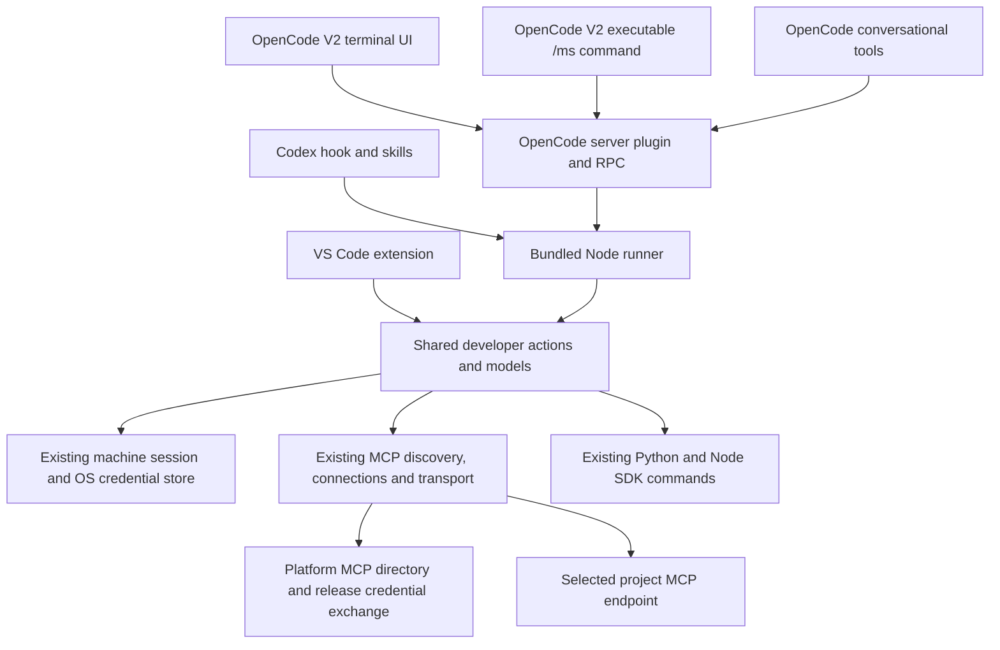

# ADR 0003: OpenCode V2 adapter in the shared developer tools package

Date: 2026-10-12

Status: Accepted by the owner's instruction to implement the OpenCode V2 adapter, keeping one npm package, executing `/ms` without an LLM, providing a native UI, and reusing existing MCP discovery and authentication. Written before implementation.

## Decision

Extend `@dev-mainsequence/devtools` in this repository with an OpenCode V2 server plugin and a terminal UI plugin. Preserve the root library export used by VS Code and the existing Codex plugin. Ship OpenCode entry points and an install command in the same npm distribution; do not create another published package or repository.

Register `/ms` as an executable server command and as a native terminal slash/palette action. Neither path submits a prompt or calls a model. Explicit commands, including invalid commands and failures, remain in this path. Markdown command templates are unsuitable because they submit work to an agent.

The terminal adapter uses OpenCode's native dialogs, selections, notifications and command palette. `/ms` opens an action menu; `/ms COMMAND ...` executes directly. Show readable results, account status, progress and cancellation, plus MCP selectors displaying project and Environment names. JSON remains a transport/export format, not the default UI. Server operations expose a typed RPC contract and live progress events so the terminal UI can connect to the executing server without owning credentials.

## Dependencies and ownership

Arrows mean “calls or depends on”. All developer tooling boxes are contents of the same npm package.

The shared dispatcher remains the single owner of developer actions, session renewal, connection persistence, canonical endpoint validation, credential exchange and MCP transport. SDKs and backend APIs require no changes. No new authentication store, MCP registry service, proxy or daemon is introduced.

OpenCode can run in a bundled Bun executable. Start the packaged runner using an actual Node 22+ executable rather than OpenCode's `process.execPath`. Use an argv array, private bounded stdin/stdout protocol, explicit working directory and process cancellation. Never change the host's global working directory. Each operation runs in the server plugin's workspace; authentication and files belong to that server machine, including when the terminal connects remotely.

## MCP integration

Expose conversational discovery, saved-connection management and catalog tools through OpenCode's tool API. Register the live schemas of selected project tools under collision-resistant release-specific namespaces. Refresh these registrations after connection changes and on explicit refresh, and restore saved selections at startup. Actual calls still reread current release access, exchange a fresh release credential and validate the current catalog through the existing client. Existing backend/release identity and platform authorization remain authoritative.

Use OpenCode's tool permission API for agent tool invocations and propagate its abort signal. Do not introduce another per-agent allowlist. Explicit user commands and UI selections are direct developer actions. Preserve uncertain-effect reporting and do not replay project writes. Persist only existing connection metadata; do not place bearer credentials in OpenCode configuration, RPC events, tool arguments or process arguments.

Implementation amendment, recorded before adding the permission bridge: actual 2.0.27 tests show that `Tool.Options.permission` controls catalog visibility but does not assert an `ask` rule before executing a plugin tool. Its published Promise/Effect plugin context also lacks a permission assertion method. Isolate the compatibility dependency in one adapter file: use the host Effect context's existing `@opencode/Permission` service and call its `assert` with the tool's session, agent, source and effective action ID, exactly as OpenCode's built-in MCP executor does. Resolve the service in the executing tool Effect fiber, after the Promise plugin registrations, and propagate cancellation. Do not copy its rule evaluator, import private host source, call an unauthenticated HTTP endpoint, or invent another approval system. If the service is absent, conversational tools fail before dispatch; explicit user commands remain executable. This service key is an internal host contract, so pin verification to 2.0.27 and migrate the small bridge when a public assertion API becomes available. Deny, allow and ask behavior are release gates.

Selected projects appear as OpenCode plugin tools. They are not separate native OpenCode MCP-server configuration entries: those entries would need an independently supported credential-renewal integration. The existing central directory is the registry used for discovery. Publishing to an external MCP registry is a separate distribution decision and is unnecessary for this adapter.

## Installation and compatibility

Provide a generated OpenCode plugin directory with its own server entry and `./tui` export, included in the single npm package. An installer places this owned artifact under the global OpenCode plugin directory or a project's `.opencode/plugins/`, without replacing unrelated configuration. This avoids changing the npm root export into a plugin definition and breaking VS Code. Expose explicit npm subpath exports for consumers that configure entry points themselves.

Support OpenCode V2 only. Its plugin API differs from V1. Document the tested host version and install/restart steps. Release a new package version; published 0.2.1 remains immutable. Installation into the running user's global environment and npm publication are separate from implementation and isolated verification.

## Verification and consequences

Verify the packaged artifact, root library compatibility, both native command registrations, no prompt/model calls for help, invalid input and sync, readable native UI interaction, progress/cancellation, workspace isolation and clean unload. Use isolated home/config directories and synthetic loopback platform/project servers to verify discovery, persisted selections, schema registration, permission denial and private credential renewal through the existing client. Run existing regression tests for Codex, SDK interoperability and authentication.

Run the adapter in an actual OpenCode V2 host when the host package is available. Distinguish host verification from mock API tests and report any unavailable host or visual checks explicitly. No real model call or live project mutation is needed.

The extra host adapter and installer increase packaging work but keep action and authentication behavior shared. Native plugin tools add host integration without changing project MCP servers. Saved selections can become unavailable; report that state and allow refresh/removal rather than silently falling back to agent execution.

References: [OpenCode V2 server plugins](https://opencode.ai/v2/docs/build/plugins/), [terminal plugins](https://opencode.ai/v2/docs/build/plugins/cli/), [plugin RPC](https://opencode.ai/v2/docs/build/plugins/rpc/), [plugin discovery and installation](https://opencode.ai/v2/docs/plugins/), and [ADR 0002](0002-conversational-project-mcp-client.md).
